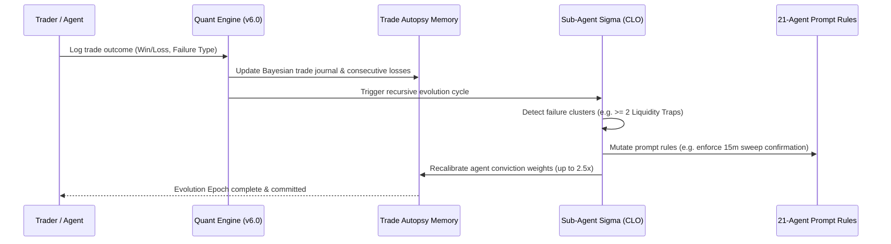

<div align="center">

# ⚡ BLOOMBERG AGENT HIVE v6.0
### Autonomous 21-Agent Self-Evolving Quantitative Trading Desk & Institutional Terminal

[](https://github.com)
[](https://github.com)
[](https://github.com)
[-ffaa00?style=for-the-badge)](https://github.com)
[](https://tradingview.com)
[](LICENSE)

<br/>

**Transform Claude Code, Cursor, Windsurf, or Antigravity into an institutional hedge-fund quantitative desk.**  
*21 autonomous specialist agents cross-examine every trade across Macro, Smart Money Concepts (SMC), Order Flow, Level-2 Market Depth, Options GEX, Alternative Maritime AIS Data, and 99% CVaR Tail-Risk Bounds.*

<br/>

[Key Highlights](#-key-highlights) •
[21-Agent Architecture](#-the-21-agent-institutional-desk) •
[Zero-Loss Protocol](#-the-zero-loss-free-trade-protocol) •
[Web Terminal](#-institutional-web-terminal--cockpit) •
[Quickstart Installation](#-1-minute-installation-guide) •
[Quant Mathematics](#-deterministic-quantitative-engine) •
[Autonomous Evolution](#-autonomous-recursive-self-evolution-sigma)

<br/>

---

```
  ____  _     ___   ___  __  __ ____  _____ ____   ____     _    ____ _____ _   _ _____   _   _ _____     _______ 
 | __ )| |   / _ \ / _ \|  \/  | __ )| ____|  _ \ / ___|   / \  / ___| ____| \ | |_   _| | | | |_ _\ \   / / ____|
 |  _ \| |  | | | | | | | |\/| |  _ \|  _| | |_) | |  _   / _ \| |  _|  _| |  \| | | |   | |_| || | \ \ / /|  _|  
 | |_) | |__| |_| | |_| | |  | | |_) | |___|  _ <| |_| | / ___ \ |_| | |___| |\  | | |   |  _  || |  \ V / | |___ 
 |____/|_____\___/ \___/|_|  |_|____/|_____|_| \_\\____|/_/   \_\____|_____|_| \_| |_|   |_| |_|___|  \_/  |_____|
                        --- INSTITUTIONAL 21-AGENT QUANT HEDGE FUND TERMINAL ---
```

---

</div>

<br/>

## 🎯 Executive Overview

Most AI trading prompts fail because they rely on a **single model hallucinating market direction** without structural risk management, liquidity awareness, or quantitative validation.

**Bloomberg Agent Hive v6.0** replaces guesswork with a **coordinated 21-agent institutional trading floor**:

1. **21 Autonomous Specialist Agents:** Each trade is independently evaluated by specialists in News Catalysts, SMC Order Blocks, CVD Delta Divergence, NSE/CME Option Chains, Dark Pool Sweeps, L2 Book Imbalances, Maritime Choke Point Flow, and Portfolio Tail Risk.
2. **Adversarial Red-Team Debate:** Sub-Agent Omega pits a dedicated Bearish Prosecutor against a Bullish Defender, running a 1,000-path jump-diffusion Monte Carlo simulation before capital is committed.
3. **The CEO Conviction Gate (90%+ Accuracy Filter):** 80%+ of mediocre setups are discarded. Only setups achieving **Grade A++ Sniper Status (Unanimous Consensus)** receive an execution ticket.
4. **The Mathematical Zero-Loss Protocol:** Engineered by Sub-Agent Pi. Scale 50% profit at TP1 (1:1 R) while trailing Stop-Loss instantly to Breakeven + transaction friction. **Worst-case outcome after TP1 = +0.5R Net Profit.**
5. **Continuous Recursive Self-Evolution:** Powered by Sub-Agent Sigma (Chief Learning Officer). Logs trade autopsies, clusters failure modes (liquidity traps, spoofing, macro shocks), mutates prompt rules, and recalibrates agent weights autonomously.
6. **Zero Dependencies:** Pure Python standard library (`http.server`, `urllib`, `json`, `math`). No heavy pip packages, no C++ compilation, no configuration hell.

<br/>

---

## 🏛️ The 21-Agent Institutional Desk

The Hive operates across **5 functional pods** governed by the **CEO Master Orchestrator**:

```mermaid
graph TD
    A[Market Symbol Ingestion] --> B[CEO Master Orchestrator]
    
    subgraph Pod 1: Core Foundation
        B --> A01[01 Alpha: News & Insider Whale Sentinel]
        B --> A02[02 Beta: Chart & SMC Matrix Specialist]
        B --> A03[03 Gamma: CVD Order Flow & Tape Absorption]
        B --> A04[04 Delta: Derivatives & Option Chain Walls]
        B --> A05[05 Epsilon: Circuit Guard & Anti-Tilt Lockout]
        B --> A06[06 Zeta: Lot & Fractional Kelly Sizer]
        B --> A07[07 Omega: Adversarial Debate & Monte Carlo]
    end

    subgraph Pod 2: Quantitative Confluence
        B --> A08[08 Eta: Intermarket Macro Correlation]
        B --> A09[09 Theta: Seasonality & Statistical Edge]
        B --> A10[10 Iota: Sentiment & Crowd Positioning]
        B --> A11[11 Kappa: Market Breadth & Volume Profile POC]
        B --> A12[12 Lambda: Wyckoff Smart Money Decoder]
    end

    subgraph Pod 3: Institutional Alpha & Microstructure
        B --> A13[13 Mu: Dark Pool & Unusual Options Sweeps]
        B --> A14[14 Nu: ICT Precision Entry & PD Arrays]
        B --> A15[15 Xi: Advanced Options Strategy Architect]
        B --> A16[16 Omicron: L2 Order Book Imbalance & Tape Velocity]
    end

    subgraph Pod 4: Convexity & Recursive Meta-Evolution
        B --> A17[17 Pi: Convexity & Zero-Loss Architect]
        B --> A18[18 Sigma: Chief Meta-Learning Officer]
    end

    subgraph Pod 5: Macro Frontier & Alternative Intelligence
        B --> A19[19 Tau: Alternative AIS Choke Points & Geopolitics]
        B --> A20[20 Upsilon: Cross-Market Lead-Lag Causality]
        B --> A21[21 Phi: Portfolio CVaR 99% Tail-Risk Shield]
    end

    A07 & A16 & A17 & A21 --> C{CEO 21-Point Sniper Accuracy Gate}
    C -->|Score >= 19/21| D[MASTER EXECUTION TICKET]
    C -->|Score < 19/21| E[CAPITAL PRESERVATION LOCKOUT: NO TRADE]
    D --> F[Live TradingView Terminal & HUD Overlays]
    F --> G[Post-Trade Autopsy Engine]
    G --> A18
```



<br/>

### Full Specialist Agent Directory

| # | Code | Agent Name | Domain & Institutional Specialty |
| :---: | :---: | :--- | :--- |
| **01** | `Alpha` | **News & Insider Sentinel** | Scans SEC Form 4, 13F whale filings, FII/DII net flows, earnings dates, and binary macro catalysts. |
| **02** | `Beta` | **Chart & SMC Specialist** | Top-down Monthly→Daily→15m matrix, unmitigated Fair Value Gaps (FVG), Order Blocks, and Liquidity Sweeps. |
| **03** | `Gamma` | **CVD Order Flow Reader** | Cumulative Volume Delta (CVD) divergence, tape absorption, and institutional iceberg order detection. |
| **04** | `Delta` | **Derivatives & OI Analyst** | NSE Option Chain open interest walls, Put-Call Ratio (PCR), Max Pain, and CFTC Commitments of Traders (COT). |
| **05** | `Epsilon`| **Risk & Circuit Guard** | 2-loss Anti-Tilt 2-hour lockout, 30m Pre-News Flat rule, and Chandelier ATR trailing stop protection. |
| **06** | `Zeta` | **Lot & Position Sizer** | Calculates exact 2026 NSE lots, forex pips, and crypto units net of exchange fees, slippage, and STT. |
| **07** | `Omega` | **Debate & Monte Carlo** | Bull vs. Bear adversarial red-team debate and 1,000-path jump-diffusion Monte Carlo simulation. |
| **08** | `Eta` | **Macro Intermarket Matrix**| DXY, US10Y, Brent Crude, and VIX correlation matrix ensuring macro tailwind alignment. |
| **09** | `Theta` | **Statistical Edge & Seasonality** | Historical day-of-week win rates, monthly cycles, and expiry week statistical tendencies. |
| **10** | `Iota` | **Sentiment & Crowd Gauge** | Fear & Greed Index, social volume spikes, and retail crowd positioning contrarian filters. |
| **11** | `Kappa` | **Breadth & Volume Profile** | Advance/Decline (A/D) ratio, Volume Profile Point of Control (POC), and VAH/VAL value areas. |
| **12** | `Lambda`| **Wyckoff Smart Money Decoder** | Accumulation/Distribution Phase A–E detection, Spring/UTAD validation, and LPS/LPSY confirmation. |
| **13** | `Mu` | **Dark Pool & Sweeps Scanner**| Off-exchange dark pool prints, Unusual Options Activity (UOA) sweeps, and Market Maker Gamma Flip levels. |
| **14** | `Nu` | **ICT Precision Entry Model** | PD Array hierarchy, Optimal Trade Entry (OTE 62%–79% Fib), Silver Bullet, and session killzones. |
| **15** | `Xi` | **Options Strategy Architect**| IV Rank/IVP regime selector, directional debit/credit spreads, Iron Condors, and futures hedges. |
| **16** | `Omicron`| **L2 Order Book Imbalance (OBI)** | Top-10 level book depth OBI score, spoofing wall detection, and tape speed acceleration. |
| **17** | `Pi` | **Convexity & Zero-Loss Architect**| Zero-Loss TP1 50% scale-out, Breakeven Lock Stop, 3-Candle Time-Stop, and Tail-Risk Black Swan Hedge. |
| **18** | `Sigma` | **Chief Meta-Learning Officer**| Autonomous continuous learning loop, cluster failure pattern recognition, and self-upgrading rules. |
| **19** | `Tau` | **Alternative Data & Choke Points**| Maritime AIS tanker tracking through Hormuz/Bab el-Mandeb, Baltic Dry, and supply chain bottlenecks. |
| **20** | `Upsilon`| **Lead-Lag Granger Causality** | Global macro domino sequence confirmation (US10Y → DXY → NQ → Nifty/BTC) before execution. |
| **21** | `Phi` | **Portfolio CVaR Risk Shield** | Clustered risk blocker (\|r\| < 0.70), 99% Conditional Value at Risk Expected Shortfall, and LVaR haircut. |

<br/>

---

## 🛡️ The Zero-Loss "Free-Trade" Protocol

Designed by **Sub-Agent Pi**, the Zero-Loss Protocol mathematically eliminates risk once the market moves +1.0R in the trade's direction:

```
[ ENTRY TRIGGER ] ─────────────────> Stop-Loss: -1.0R (Risk: 1% of Capital)
        │
        │  Price moves to TP1 (+1.0R)
        ▼
[ TP1 HIT: SCALE 50% ] ────────────> Lock +0.5R Net Cash Profit
        │
        │  Stop-Loss trailing trigger
        ▼
[ SL MOVES TO BREAKEVEN + FRICTION ]
        │
        ├───> Scenario A: Price hits SL at Breakeven ──> Total Trade Profit = +0.5R Net
        │
        └───> Scenario B: Price hits Runner TP2 (+2.5R) ─> Total Trade Profit = +1.75R Net
```

### Mathematical Guarantee:
$$\text{Expected PnL}_{\text{worst-case}} = (0.50 \times +1.0R) - (0.50 \times 0.0R) - \text{Friction} = \mathbf{+0.5R\ (Guaranteed\ Positive)}$$

### The 3-Candle Time-Stop:
If institutional displacement does not materialize within **3 candles (45 minutes on a 15m chart)**, Sub-Agent Pi triggers a **Scratch Exit** at market price. Capital is preserved and reallocated.

<br/>

---

## 💻 Institutional Web Terminal & Cockpit

The Hive includes a **Bloomberg-grade visual terminal** hosted locally on `http://localhost:5050`:

<div align="center">
  
</div>

### Features:
- 📈 **TradingView Live Advanced Charts:** Seamless real-time charts for Indian Indices (`NSE:NIFTY`, `NSE:BANKNIFTY`, `BSE:SENSEX`), Global Equities (`NSE:RELIANCE`), Forex (`OANDA:XAUUSD`), and Crypto (`BINANCE:BTCUSDT`).
- 🎯 **Real-Time Level Overlays:** Floating HUD pills displaying exact Buy/Sell Trigger, Hard Stop Loss, Zero-Loss TP1, and Primary Runner TP2.
- 🚦 **CEO Conviction Meter:** Real-time consensus gauge (0 to 21) with automatic trade-grade classification.
- 🎛️ **Interactive 21-Agent Radar:** Click any sub-agent card to view detailed multi-timeframe reasoning, confluence scores, and live risk parameters.
- ⚡ **Zero-Dependency Backend:** Built on Python standard library `http.server` with live JSON signal exchange (`/api/latest-signals` and `/api/push-signals`).

<br/>

---

## ⚡ 1-Minute Installation Guide

Install Bloomberg Agent Hive into your preferred AI agent environment with a single command:

### Option 1: Claude Code (`claude-code`)
```bash
# Clone directly into your Claude project or skills root
git clone https://github.com/your-username/bloomberg-agent-hive.git ~/.claude/skills/bloomberg-agent-hive
```
*Claude Code will automatically detect `SKILL.md` and equip the 21 agents.*

---

### Option 2: Cursor IDE
1. Clone the repository into your workspace:
   ```bash
   git clone https://github.com/your-username/bloomberg-agent-hive.git
   ```
2. Copy the skill instructions to `.cursor/rules/bloomberg-agent-hive.mdc` or add to project rules.
3. Prompt Cursor:
   > *"Run a 21-agent quantitative scan on Nifty 50 for today's session."*

---

### Option 3: Antigravity / Gemini CLI
```bash
# Copy into global Antigravity skills directory
git clone https://github.com/your-username/bloomberg-agent-hive.git ~/.gemini/config/skills/bloomberg-agent-hive
```

---

### Option 4: Standalone Terminal & Web Cockpit
Run the terminal locally with **zero external dependencies**:
```bash
git clone https://github.com/your-username/bloomberg-agent-hive.git
cd bloomberg-agent-hive

# Launch the visual web terminal (opens at http://localhost:5050)
python scripts/web_terminal.py

# Or launch the interactive visual ANSI terminal cockpit
python scripts/terminal_cockpit.py --symbol NIFTY --price 24850
```

<br/>

---

## 🧮 Deterministic Quantitative Engine

The engine (`scripts/quant_engine.py`) operates with **zero external pip dependencies**, running pure mathematical algorithms:

```bash
# Run full quantitative analysis on any symbol
python scripts/quant_engine.py --symbol "NIFTY" --capital 100000 --risk 1.0
```

### Core Algorithms Implemented:
1. **1,000-Path Jump-Diffusion Monte Carlo Simulation:**
   $$S_{t+\Delta t} = S_t \exp\left( (\mu - \frac{1}{2}\sigma^2)\Delta t + \sigma \sqrt{\Delta t} Z \right) \times \prod_{j=1}^{N(\Delta t)} Y_j$$
   Determines empirical probabilities of hitting TP1 vs. SL under stochastic volatility.

2. **Fractional Kelly Criterion Sizing:**
   $$f^* = \frac{p \cdot b - q}{b} \times \text{Fractional Multiplier}$$
   Prevents over-leveraging and guarantees long-term geometric compounding.

3. **Risk of Ruin Equation:**
   $$\text{RoR} = \left( \frac{1 - A}{1 + A} \right)^U \quad \text{where } A = (2p - 1)$$
   Calculates probability of account drawdown exceeding safety thresholds over 100 trades.

4. **Level-2 Order Book Imbalance (OBI):**
   $$\text{OBI} = \frac{\sum_{i=1}^{10} V_{\text{bid},i} - \sum_{i=1}^{10} V_{\text{ask},i}}{\sum_{i=1}^{10} V_{\text{bid},i} + \sum_{i=1}^{10} V_{\text{ask},i}}$$
   Detects institutional iceberg orders and front-runs order book displacement.

5. **99% Conditional Value at Risk (CVaR / Expected Shortfall):**
   $$\text{CVaR}_\alpha = \frac{1}{1-\alpha} \int_0^{1-\alpha} \text{VaR}_\gamma(X) \, d\gamma$$
   Measures tail-risk loss beyond the 99% VaR cutoff to protect against black swan shocks.

<br/>

---

## 🧬 Autonomous Recursive Self-Evolution (Sigma)

Sub-Agent **Sigma** functions as the desk's **Chief Learning Officer**. It operates a continuous recursive feedback loop:



### Logging a Trade Outcome:
```bash
# Log a trade outcome to trigger recursive autopsy
python scripts/quant_engine.py --mode autopsy --outcome loss --failure-type liquidity_trap --notes "Trapped at equal highs"

# Trigger autonomous self-evolution & prompt rule mutation
python scripts/quant_engine.py --mode evolve
```

### Supported Failure Typologies:
`liquidity_trap` • `microstructure_spoof` • `macro_shock` • `cvd_false_positive` • `timing_iv_flaw` • `wyckoff_phase_wrong` • `dark_pool_missed` • `unhedged_black_swan` • `lead_lag_divergence`

<br/>

---

## 📁 Repository Architecture

```
bloomberg-agent-hive/
├── SKILL.md                               # Master AI Skill Definition & CEO Orchestrator Prompt
├── README.md                              # Institutional Documentation & Setup Guide
├── agents/                                # 21 Autonomous Specialist Agent Protocols
│   ├── 01-news-insider-sentinel.md        # Sub-Agent Alpha: SEC 13F/Form 4, FII/DII Flows
│   ├── 02-chart-smc-specialist.md         # Sub-Agent Beta: SMC, Order Blocks, FVGs
│   ├── 03-order-flow-cvd-reader.md        # Sub-Agent Gamma: Cumulative Volume Delta
│   ├── 04-derivatives-institutional-flow.md# Sub-Agent Delta: NSE/CME Option Chains, COT
│   ├── 05-risk-invalidations-guard.md     # Sub-Agent Epsilon: Anti-Tilt, Circuit Breakers
│   ├── 06-lot-position-calculator.md      # Sub-Agent Zeta: Exact NSE 2026 Lot/Share Sizer
│   ├── 07-adversarial-monte-carlo-autopsy.md# Sub-Agent Omega: Bull/Bear Debate, Monte Carlo
│   ├── 08-intermarket-macro-correlation.md# Sub-Agent Eta: DXY, US10Y, Crude, VIX Matrix
│   ├── 09-seasonality-statistical-edge.md # Sub-Agent Theta: Day/Month Seasonality Edges
│   ├── 10-sentiment-intelligence-crowd-gauge.md# Sub-Agent Iota: Crowd Contrarian Sentiment
│   ├── 11-breadth-momentum-volume-profile.md# Sub-Agent Kappa: Volume Profile POC, VAH/VAL
│   ├── 12-wyckoff-smart-money-decoder.md  # Sub-Agent Lambda: Wyckoff Phase A–E & Springs
│   ├── 13-dark-pool-unusual-options-flow.md# Sub-Agent Mu: Dark Pool Prints, MM Gamma Flip
│   ├── 14-ict-precision-entry-model.md    # Sub-Agent Nu: ICT PD Arrays, OTE 62-79% Fib
│   ├── 15-advanced-options-strategy-architect.md# Sub-Agent Xi: IV Rank Spreads & Condors
│   ├── 16-order-book-imbalance-microstructure.md# Sub-Agent Omicron: L2 Book Imbalance (OBI)
│   ├── 17-delta-neutral-convex-hedging.md # Sub-Agent Pi: Zero-Loss Protocol & Time-Stop
│   ├── 18-recursive-meta-learning-optimizer.md# Sub-Agent Sigma: Autonomous Prompt Evolution
│   ├── 19-alternative-data-geopolitical-supply-chain.md# Sub-Agent Tau: Maritime AIS Choke Points
│   ├── 20-cross-market-lead-lag-causality.md# Sub-Agent Upsilon: Macro Granger Causality
│   └── 21-portfolio-cvar-correlation-shield.md# Sub-Agent Phi: 99% CVaR Tail Risk Shield
├── playbooks/                             # Asset-Class Specific Execution Rulebooks
│   ├── india-nse-bse.md                   # Nifty, BankNifty, Sensex, Indian Stocks
│   ├── forex-gold-commodities.md          # EUR/USD, GBP/USD, Gold (XAU), Crude Oil
│   └── crypto-perps-onchain.md            # BTC, ETH, SOL, Perpetual Futures, Funding
├── scripts/                               # Deterministic Quant Engine & Cockpit
│   ├── quant_engine.py                    # Pure Python 21-Agent Math Engine (Zero-Pip)
│   ├── terminal_cockpit.py                # Visual ANSI Terminal Cockpit Dashboard
│   └── web_terminal.py                    # One-Click Web Terminal Launcher
└── web/                                   # Institutional Web Terminal (Port 5050)
    ├── index.html                         # Terminal HTML5 Interface
    ├── index.css                          # High-End Glassmorphism Dark Theme Styling
    ├── app.js                             # TradingView Embed & Gemini Signal Polling
    ├── server.py                          # Zero-Dependency Python HTTP/REST API Server
    └── live_signals.json                  # Live Signal State Exchange File
```

<br/>

---

## 🌐 Supported Markets & Assets

| Asset Class | Primary Instruments | Supported Exchanges / Feeds |
| :--- | :--- | :--- |
| **Indian Indices** | Nifty 50, Bank Nifty, Sensex, FinNifty | National Stock Exchange of India (NSE), BSE |
| **Indian Equities** | Reliance, HDFC Bank, ICICI Bank, Tata Motors | NSE Cash & F&O Segments (2026 Lot Specifications) |
| **Commodities** | Gold (XAU/USD), Silver (XAG/USD), WTI / Brent Crude | OANDA, TVC, MCX |
| **Foreign Exchange** | EUR/USD, GBP/USD, USD/JPY, USD/INR | FXCM, OANDA, Interbank Feeds |
| **Cryptocurrencies** | Bitcoin (BTC), Ethereum (ETH), Solana (SOL) | Binance, Bybit, OKX, Coinbase Perps & Spot |

<br/>

---

## ⚖️ Risk Disclaimer

> **IMPORTANT NOTICE:**  
> This software is an advanced open-source quantitative research tool and framework for algorithmic and AI-assisted trading systems. **It does not constitute financial, investment, or legal advice.** Trading equities, derivatives, forex, and cryptocurrencies carries significant risk of financial loss. Never risk capital you cannot afford to lose. Always perform your own independent diligence and test strategies on simulated paper trading environments before deploying real capital.

<br/>

---

## 🤝 Contributing & Community

Contributions from quantitative researchers, algorithmic traders, and AI agent developers are enthusiastically welcomed!

1. Fork the Project (`https://github.com/thesinnersahil07/tradingwithai/fork`)
2. Create your Feature Branch (`git checkout -b feature/AlphaUpgrade`)
3. Commit your Changes (`git commit -m 'feat: Add Volatility Surface Skew to Sub-Agent Xi'`)
4. Push to the Branch (`git push origin feature/AlphaUpgrade`)
5. Open a Pull Request

<br/>

---

<div align="center">

### ⭐ If this project elevates your trading, consider starring the repository! ⭐

**Engineered with precision for institutional algorithmic superiority.**

[Back to Top ↑](#-bloomberg-agent-hive-v60)

</div>
